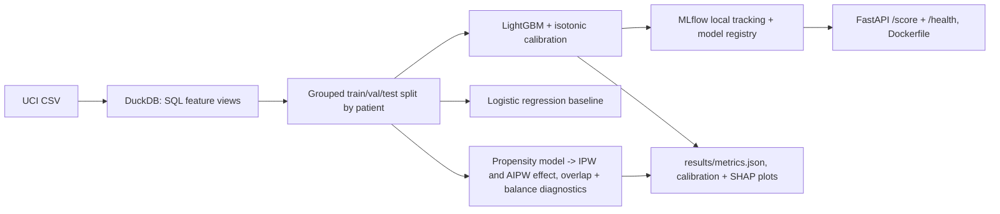

# Hospital readmission risk service

This project scores 30-day hospital readmission on the UCI Diabetes 130-US Hospitals encounters (1999-2008). DuckDB builds SQL features, a patient-grouped split keeps every person in one fold, and a LightGBM model is calibrated with isotonic regression fit on the validation fold only. An L2 logistic regression uses the same features as the baseline. A local MLflow registry stores the model, and a FastAPI service scores one engineered row at a time. A separate propensity-score analysis estimates the observational association between an in-hospital diabetes medication change and readmission, with overlap and balance checks.

The predictive test fold is not used to fit, tune, calibrate, or choose thresholds. The causal fit uses train and validation encounters only. Estimates from the causal section are observational and depend on the assumptions in `results/causal_analysis.md`.

## Setup

Python 3.11 or 3.12 on Windows:

```
python -m venv .venv
.venv\Scripts\pip install -r requirements.txt
```

## How to run

```
python run.py
python run.py --quick
python run.py --device cpu
```

`python run.py` downloads the CSV into `data/` (cached), rebuilds features, trains, evaluates, benchmarks 500 local scoring requests, runs the test suite to record coverage, and writes `results/`. `python run.py --quick` uses a seeded subset of patients so the same path finishes in a few minutes. `--device cuda` is accepted and recorded; training stays on CPU.

The scoring process is:

```
python -m uvicorn src.service:app --host 127.0.0.1 --port 8000
```

Train first so `models/calibrated_lgbm.joblib` exists. `Dockerfile` runs that service. Tests:

```
python -m pytest
```

## Architecture



## Design decisions

- Encounters are grouped by `patient_nbr` before the split. A person with several stays cannot appear in both train and test.
- Discharges to death or hospice (disposition ids 11, 13, 14, 19, 20, 21) are removed. Those patients are not eligible for readmission.
- Prior stays are counted in SQL with a window ordered by `encounter_id`, using only earlier encounters. The dataset's own `number_inpatient`, `number_emergency`, and `number_outpatient` fields are kept as well, because they record utilization before the stay.
- Diagnosis codes are grouped from ICD-9 chapters inside DuckDB. Medication features count dose increases, decreases, and active diabetes drugs.
- LightGBM hyperparameters are chosen by validation AUROC. Isotonic regression is fit on the validation scores of the chosen model. The test fold is scored once at the end.
- The logistic baseline is L2-penalized and sees the same train-only encoding.
- The causal treatment is the recorded medication-change flag. Covariates are limited to attributes that are available before that decision, plus A1C group, which can be measured during the stay (see the report). Propensity penalty and clipping are chosen to improve covariate balance, without looking at the outcome. Intervals are patient-cluster bootstraps of the fixed scores.
- The API validates the engineered feature payload. It does not recompute the SQL features.

## Limitations

- The extract covers 1999-2008. Practice patterns and coding have changed.
- `encounter_id` order is treated as time order within a patient. The file has no admission timestamp.
- Readmission risk is predictable in part from prior utilization and discharge location. Discrimination on this public extract is modest.
- The medication-change estimate can still be confounded by unmeasured illness. Clipping extreme propensities also shifts the population slightly.
- Calibration was fit on the same validation fold used for early stopping and model choice, so validation metrics are a bit optimistic. Test metrics are the ones that count.
- The service expects the training feature columns. It is not a raw-encounter clinical API.
- SHAP values describe the uncalibrated tree model on a test sample. They are not a full explanation of the calibrated probability.

## Dataset

UCI Machine Learning Repository, Diabetes 130-US Hospitals for Years 1999-2008.

https://archive.ics.uci.edu/dataset/296/diabetes+130-us+hospitals+for+years+1999-2008

License: CC BY 4.0. The pipeline checks the published row count of 101,766 and the SHA-256 of the cached CSV.

## Evaluation artifacts

These files are written by `python run.py` and are enough to recompute the headline metrics. `encounter_id` matches the source file.

| File | Role |
|---|---|
| `results/test_predictions.csv` | Test `encounter_id`, `patient_nbr`, `y_true`, `p_lightgbm`, `p_baseline` |
| `results/val_predictions.csv` | Validation scores used only as a record of calibration |
| `results/split_assignments.csv` | Encounter-to-split map |
| `results/calibration_bins.csv` | 10-bin test calibration table |
| `results/causal_scores.csv` | Treatment, outcome, propensity, weight, AIPW score |
| `results/causal_covariates.csv` | Covariates, treatment, and IPW weight for SMD checks |
| `results/smd_table.csv` | Unweighted and weighted standardized mean differences |
| `results/metrics.json` | Metrics, baseline, splits, seeds, hardware, runtime |
| `results/causal_analysis.md` | Assumptions and effect estimates |

## Results

<!-- RESULTS_TABLE_START -->
| Criterion | Value | Rule | Passed |
|---|---:|---|---|
| Test AUROC (30-day readmission) | 0.6813792057328326 | >= 0.66 | yes |
| Test AUROC (30-day readmission) lift over baseline | 0.019085083014274695 | >= 0.01 | yes |
| Expected calibration error | 0.005493943244526478 | <= 0.03 | yes |
| Covariate balance after weighting | 0.02857282477751592 | < 0.1 | yes |
| Scoring API p95 latency | 6.698775002587354 | < 100.0 | yes |
| Test coverage of src/ | 88.25214899713467 | >= 75.0 | yes |

| Metric | Value |
|---|---:|
| Test AUROC, calibrated LightGBM | 0.6813792057328326 |
| Test AUROC, L2 logistic baseline | 0.6622941227185579 |
| Test ECE, calibrated LightGBM | 0.005493943244526478 |
| AIPW risk difference | 0.008060354639866983 |
| IPW risk difference | 0.007092148228606043 |
| Naive risk difference | 0.010865179048724097 |
| Max weighted absolute SMD | 0.02857282477751592 |
| Scoring p95 latency (ms) | 6.698775002587354 |
| Runtime (seconds) | 57.86347700000624 |

All success criteria passed on this run.

Plots: `results/calibration_curve.png`, `results/shap_summary.png`, `results/propensity_overlap.png`, `results/smd_balance.png`.
<!-- RESULTS_TABLE_END -->
