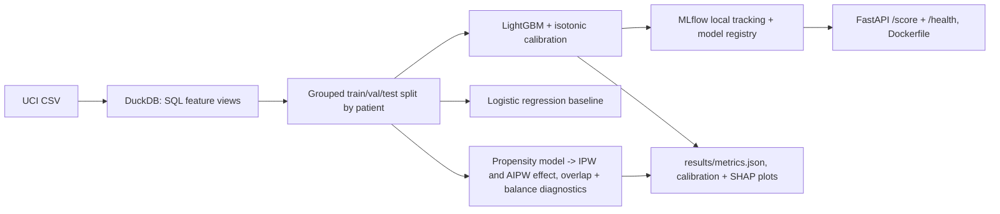

# Hospital Readmission Risk Service with Causal Program-Effect Analysis

`healthcare-readmission-mlops` · new project · estimated build effort: 4 h

## Problem

Value-based care organizations need to flag patients likely to be readmitted within 30 days and to know whether an intervention actually helps. This project builds a readmission-risk pipeline on 100k real de-identified diabetic inpatient encounters. It covers SQL feature engineering, a gradient-boosted model with calibration, MLflow tracking, and a FastAPI scoring service with a Dockerfile. It also estimates the observational effect of a care decision (a change in diabetes medication) on readmission using propensity-score methods, with diagnostics.

## Target jobs and skills

- **Somatus — Machine Learning Engineer** (`8fc4dabf2b67`): covers 74% of the JD's weighted top skills (Python, SQL, Machine Learning, Git, MLOps, Healthcare Data, Docker, Causal Inference, Feature Engineering)

Skills/tools this project demonstrates: Python, SQL, Machine Learning, Healthcare Data, Clinical Data, Classification, Gradient Boosting, LightGBM, Causal Inference, Feature Engineering, MLOps, MLflow, FastAPI, Docker, Model Evaluation, Statistics, Git

## Data

- **Dataset:** UCI Diabetes 130-US Hospitals for Years 1999-2008 — https://archive.ics.uci.edu/dataset/296/diabetes+130-us+hospitals+for+years+1999-2008
- **License/terms:** CC BY 4.0
- **Size used:** 101,766 encounters, 50 columns, ~19 MB
- **Plan:** Split by patient_nbr (grouped split) so a patient's encounters never appear in both train and test. Load into DuckDB and build features in SQL.

## Architecture

## Tech stack

Python 3.11, DuckDB, LightGBM, scikit-learn, MLflow (local file store), FastAPI, uvicorn, SHAP, pytest

## Deliverables

- SQL feature views (diagnosis groupings, prior utilization, medication changes) with data-quality checks
- Calibrated LightGBM model registered in a local MLflow model registry
- FastAPI service with input validation and a latency benchmark script (no Docker needed to run it; Dockerfile provided)
- Causal analysis notebook-free report (markdown) with IPW/AIPW estimates, bootstrap CIs, standardized mean differences

## Success criteria (all must hold on a from-scratch `python run.py`)

| Metric | Threshold | How it is measured |
|---|---|---|
| Test AUROC (30-day readmission) | >= 0.66 and >= baseline + 0.01 | held-out patients |
| Expected calibration error | <= 0.03 | 10-bin ECE on test |
| Covariate balance after weighting | all standardized mean differences < 0.1 | IPW-weighted SMDs |
| Scoring API p95 latency | < 100 ms per single-record request (local, 500 requests) | benchmark script |
| Test coverage of src/ | >= 75% | pytest --cov |

## Baseline

L2 logistic regression on the same features; for the causal analysis, the naive difference in readmission rates.

## Constraints

- Runs on Windows with `python run.py` from a fresh virtualenv; no make, shell scripts, paid APIs, or accounts.
- CPU-only by default (an optional `--device cuda` flag is fine); peak RAM <= 3 GB; total downloads <= 1.5 GB.
- PyTorch (if used) pinned to the CPU wheel via `--extra-index-url https://download.pytorch.org/whl/cpu`.
- Fixed random seeds; every reported number is written by code to results/metrics.json (never typed by hand).
- Test split is created once, saved, and never used for training, tuning, or threshold selection.
- Data download is scripted (Python requests), cached under data/, and verified by checksum or row count.
- The causal estimate is reported as observational with its assumptions stated; no causal claim beyond that.

## Draft resume bullets (placeholders are filled only with reproduced metrics)

- Built a 30-day readmission model on 101,766 inpatient encounters with SQL features in DuckDB and calibrated LightGBM, reaching [AUROC] AUROC on held-out patients ([ECE] ECE)
- Served the model through a FastAPI endpoint at [P95_MS] ms p95 latency, with experiments and model versions tracked in an MLflow registry
- Estimated the effect of medication changes on readmission with IPW and AIPW ([EFFECT] pts, 95% CI [CI]), checking overlap and covariate balance (max SMD [SMD])
